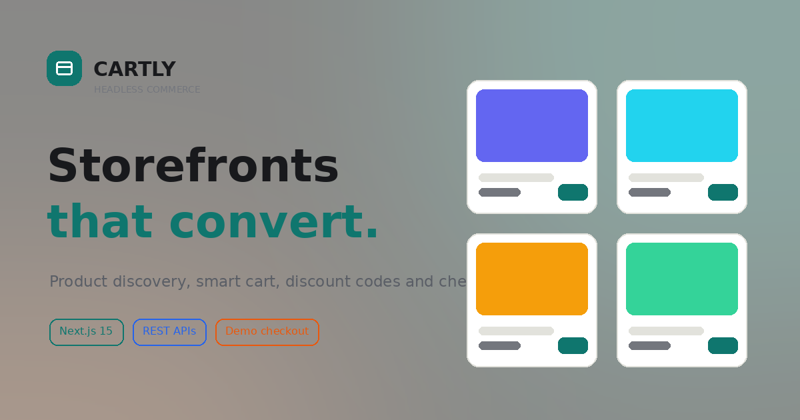

# Cartly — Headless Commerce Storefront

> A polished, production-style storefront with product discovery, a smart cart, discount codes and a demo checkout.


---

## ✨ What it does

Cartly is a complete front-end commerce experience backed by typed Next.js API routes. It demonstrates the full browse → cart → checkout → order-confirmation flow without needing any payment keys.

- **Catalog** — 12 products across 5 categories with generated artwork, badges, ratings and sale prices
- **Discovery** — live search, category pills and four sort modes (featured, price ↑/↓, rating)
- **Smart cart** — add/increment/remove, persistent drawer, quantity controls and running totals
- **Discounts** — `WELCOME10` applies 10% off; free shipping kicks in over $100
- **Checkout** — validated form, server-side price recalculation, order ID and confirmation screen
- **Order history** — list previously placed orders from the API
- **Zero config** — no keys, no external services; runs immediately after `npm install`

> Security detail: the checkout API recomputes every price from the catalog instead of trusting client-sent totals.

## 🛠️ Tech stack

| Layer | Choice |
|---|---|
| Framework | Next.js 15 (App Router, React 19) |
| Language | TypeScript (strict) |
| Styling | Tailwind CSS v4 |
| Images | `next/image` with locally generated artwork |
| State | React hooks (cart, filters, modals) |
| APIs | Next.js route handlers (`/api/products`, `/api/orders`, `/api/health`) |
| Data | In-process catalog + order store; optional Neon Postgres schema |

## 🚀 Run locally

```bash
git clone https://github.com/<your-username>/cartly.git
cd cartly
npm install
npm run dev
```

Open [http://localhost:3000](http://localhost:3000). Try the code **WELCOME10** in the cart.

## 📡 API

| Endpoint | Description |
|---|---|
| `GET /api/products?category=Audio&q=head&sort=rating` | Filtered, sorted catalog |
| `GET /api/products/[slug]` | Product detail (404 when missing) |
| `POST /api/orders` | `{ customer, items: [{ slug, quantity }], discountCode }` — prices recalculated server-side |
| `GET /api/orders` | All placed orders |
| `GET /api/health` | Service status and counts |

## 📁 Structure

```
src/
├── app/api/{products,products/[slug],orders,health}/route.ts
├── components/{Storefront,ProductCard,CartDrawer,CheckoutModal,OrdersModal}.tsx
└── lib/{products,orders,types}.ts
scripts/{generate_images.py,generate_cover.py,seed.sql}
```

## 📸 Cover



Regenerate artwork with `python3 scripts/generate_images.py` and the cover with `python3 scripts/generate_cover.py`.

## 🎯 Portfolio blurb

> Built Cartly, a headless e-commerce storefront in Next.js 15 and TypeScript. Implemented product discovery with search/filter/sort, a smart cart drawer, discount codes, free-shipping rules and a demo checkout flow backed by typed API routes. Added server-side price recalculation for order integrity, generated product artwork, an order-history view and complete documentation.

## ✅ Quality checks

```bash
npm run lint
npm run typecheck
npm run build
```

## License

MIT — free to use for personal and commercial projects.
